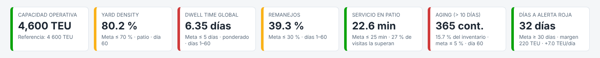
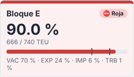
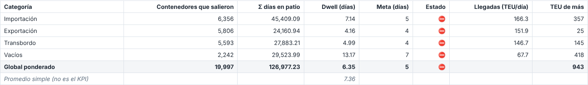
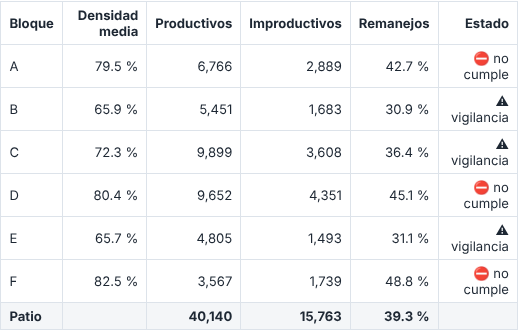
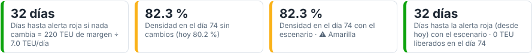

# Verificación manual de KPI

Responsable: **Adriana Garibaldi** · Datos simulados (semilla 2026) · Día de corte 60, días 1–60, sin filtros.

El curso pide verificar a mano al menos 3 KPI. Aquí se verifican **5 KPI** (6 comparaciones). Para cada uno hay:
1. una captura del dashboard;
2. el cálculo a mano con los datos de los CSV de `data/`;
3. la diferencia.

Los mismos cálculos están en Excel, con fórmulas, en [`verificacion_manual.xlsx`](verificacion_manual.xlsx). La hoja **Resumen** compara cada valor con el dashboard. En las hojas de detalle se pueden cambiar el día, el bloque o la ventana (celdas amarillas) para repetir la prueba en vivo.

## Resumen

| KPI | Dashboard | Cálculo a mano / Excel | Diferencia | Resultado |
|---|---|---|---|---|
| 1 · Capacidad operativa | 4 600 TEU | 4 600 TEU | 0 | ✔ coincide |
| 2 · Yard Density del patio (día 60) | 80.2 % | 80.22 % | redondeo | ✔ coincide |
| 2 · Yard Density del bloque E (día 60) | 90.0 % | 90.00 % | 0 | ✔ coincide |
| 4 · Dwell time global ponderado | 6.35 días | 6.350 días | redondeo | ✔ coincide |
| 5 · Remanejos del patio | 39.3 % | 39.27 % | redondeo | ✔ coincide |
| 8 · Días hasta alerta roja | 32 días | 31.6 días | redondeo a días enteros | ✔ coincide |

---

## 1. Capacidad operativa ✔

**Fórmula del curso:** [Bloques × Stacks × (Tiers × Lanes − Shuffle slots)] − slots inoperativos

| Parámetro | Valor |
|---|---|
| Bloques | 6 |
| Stacks | 30 |
| Tiers | 5 |
| Lanes | 6 |
| Shuffle slots | 4 |
| Slots inoperativos | 80 (40 en C y 40 en E) |

[6 × 30 × (5 × 6 − 4)] − 80
= [6 × 30 × 26] − 80
= 4 680 − 80
= **4 600 TEU**

Por bloque: 30 × 26 = 780 TEU; C y E tienen 780 − 40 = 740 TEU. Suma: 4 × 780 + 2 × 740 = 4 600 ✔

**Dashboard: 4 600 TEU · Diferencia: 0**

## 2. Yard Density (día 60) ✔

**Fórmula del curso:** Inventario ÷ capacidad operativa × 100. El inventario es el TEU al cierre del día, en `inventarioDiario.csv`.

**Bloque E, día 60.** En el CSV se suman las 4 filas con `dia = 60` y `bloque = E` (VAC + EXP + IMP + TRB):
- Inventario del bloque = **666 TEU**
- Capacidad del bloque E = 30 × 26 − 40 = **740 TEU**
- Densidad = 666 ÷ 740 × 100 = **90.0 %** (⛔ roja, > 85 %)

**Patio completo, día 60.** Se suman las 24 filas con `dia = 60`:
- Inventario = **3 690 TEU**
- Densidad = 3 690 ÷ 4 600 × 100 = **80.22 %** (⚠ amarilla)

**Dashboard: 90.0 % (bloque E) y 80.2 % (patio) · Diferencia: 0 y redondeo a un decimal**

En Excel (hoja *Densidad*): `=SUMIFS(teu; dia; 60; bloque; "E")` ÷ capacidad del bloque.

## 3. Dwell time global ponderado ✔

**Fórmulas del curso:**
- Dwell por categoría = Σ días en patio ÷ contenedores de la categoría.
- Dwell global = promedio **ponderado** por contenedores (no promedio simple).

Se usan los contenedores que **salieron** entre los días 1 y 60 (columna `dias_en_patio` de `contenedores.csv`).

| Categoría | Contenedores | Σ días en patio | Dwell (días) |
|---|---|---|---|
| Importación | 6 356 | 45 409.09 | 7.14 |
| Exportación | 5 806 | 24 160.94 | 4.16 |
| Transbordo | 5 593 | 27 883.21 | 4.99 |
| Vacíos | 2 242 | 29 523.99 | 13.17 |
| **Global ponderado** | **19 997** | **126 977.23** | **126 977.23 ÷ 19 997 = 6.35** |
| Promedio simple (no es el KPI) | | | (7.14 + 4.16 + 4.99 + 13.17) ÷ 4 = 7.36 |

**Dashboard: 6.35 días · Diferencia: 0 (a dos decimales)**

**Por qué el promedio simple da otro número:** el simple le da el mismo peso a cada categoría. Los vacíos son solo el 11 % de los contenedores (2 242 de 19 997), pero con un dwell de 13.17 días suben el simple a 7.36. El ponderado cuenta cada contenedor una vez, por eso es el que refleja lo que vive el patio.

**Cálculo a mano con una muestra.** En Excel (hoja *Dwell*, parte B) hay 20 contenedores elegidos al azar con semilla 2026: 5 por categoría, entre los que salieron los días 55 a 60.

| Categoría | Contenedores (días en patio) | Σ días | Dwell |
|---|---|---|---|
| Importación | 8.93 + 4.52 + 4.91 + 3.22 + 2.81 | 24.39 | 4.88 |
| Exportación | 4.53 + 3.87 + 3.72 + 1.96 + 2.19 | 16.27 | 3.25 |
| Transbordo | 6.74 + 4.91 + 5.20 + 5.73 + 5.38 | 27.96 | 5.59 |
| Vacíos | 17.49 + 16.40 + 16.71 + 16.33 + 16.38 | 83.31 | 16.66 |
| **Ponderado** | 20 contenedores | 151.93 | 151.93 ÷ 20 = **7.60** |

En esta muestra el ponderado y el simple dan lo mismo (7.60), porque las 4 categorías tienen el mismo número de contenedores. La diferencia solo aparece cuando las categorías tienen distinto tamaño, como en los datos completos.

## 4. Remanejos (rehandle ratio) ✔

**Fórmula del curso:** Movimientos improductivos ÷ movimientos productivos × 100 (`movimientos.csv`).

- Σ productivos = **40 140**
- Σ improductivos = **15 763**
- Remanejos = 15 763 ÷ 40 140 × 100 = **39.27 %** (⚠ meta ≤ 30 %)

| Bloque | Productivos | Improductivos | Remanejos |
|---|---|---|---|
| A | 6 766 | 2 889 | 42.7 % |
| B | 5 451 | 1 683 | 30.9 % |
| C | 9 899 | 3 608 | 36.4 % |
| D | 9 652 | 4 351 | 45.1 % |
| E | 4 805 | 1 493 | 31.1 % |
| F | 3 567 | 1 739 | 48.8 % |

**Dashboard: 39.3 % · Diferencia: redondeo a un decimal**

## 5. Días hasta alerta roja ✔

**Fórmula del curso:** TEU de margen ÷ crecimiento diario del inventario.

- Inventario del día 60 = **3 690 TEU**
- TEU de margen = 85 % × 4 600 − 3 690 = 3 910 − 3 690 = **220 TEU**
- Crecimiento diario = pendiente de mínimos cuadrados del inventario total entre los días 32 y 60 (28 días). En Excel: `=SLOPE(inventario; día)` = **6.97 TEU/día**
- Días hasta alerta roja = 220 ÷ 6.97 = **31.6 días**

**Dashboard: 32 días · Diferencia: el dashboard redondea a días enteros (31.6 → 32)**

Por qué una ventana de 28 días: con ventanas más cortas el resultado depende del ciclo de buques. Con la diferencia simple entre los días 46 y 60 da +26.9 TEU/día, y con la pendiente de 14 días +15.4. Ver la ficha 8 en `docs/fichas_kpi.md`.

---

## Cómo repetir la verificación

1. Abrir `verificacion_manual.xlsx`. La hoja **Resumen** muestra ✔ en cada fila.
2. En la hoja *Densidad*, cambiar el día (B4) o el bloque (B5) y comparar con el Módulo 1 del dashboard puesto en ese día.
3. En la hoja *AlertaRoja*, cambiar el día de corte (B4) y comparar con la tarjeta "Días a alerta roja" con ese "Día hasta".
4. Para comprobar que los CSV son los mismos datos del dashboard: `node data/exportar_csv.js` los vuelve a generar desde `index.html` con la misma semilla.
